  

  
  
  
  

  

I study **Data Science at Texas State University** (Honors College, 4.0) and do research in the **OK Lab** with Dr. Oleg Komogortsev. My work sits where hardware meets ML: I measure how good the eye trackers in VR headsets really are, and I train models that recognize people from the way their eyes move.

- 🔬 **Now:** adapting eye-movement biometric models to Meta Quest Pro, using public lab-grade data degraded to headset signal quality
- 📄 **Recently:** first-authored a 30-participant comparison of three VR eye trackers (submitted to ACM ETRA 2027)
- 🛠️ **Learning:** SQL and larger-scale multi-dataset training

## 📄 Research

Thirty people, three headsets, one protocol. Mean error ranks the headsets, but diagnostics on each device's own clock show what it hides: multi-second stream pauses, closed eyes reported as valid gaze, and heavy internal filtering. It is also the first published evaluation of the VIVE Focus Vision eye tracker. I led data collection, adapted the Unity acquisition apps to all three headsets, built the analysis pipeline, and released the data and code.

## 🧪 Projects

<table>
<tr>
<td width="50%" valign="top">

### [👁️ Eye Know You Too](https://github.com/AleksandrChernysh/ekyt-reimplementation)
Re-implementation of a deep metric-learning model that identifies a person from **5 seconds of eye movements**. Trained on GazeBase with subject-disjoint evaluation.

`PyTorch Lightning` `metric learning` `biometrics`

</td>
<td width="50%" valign="top">

### [⌨️ Webcam Gaze Keyboard](https://github.com/AleksandrChernysh/webcam-gaze-keyboard)
Real-time eye tracking with an ordinary laptop webcam — calibration, built-in accuracy measurement (~2°), and a keyboard you type on with your eyes.

`OpenCV` `MediaPipe` `scikit-learn`

</td>
</tr>
</table>

## 🧰 Tools

  

Also: pandas · NumPy · SciPy · OpenCV · MediaPipe · Meta Quest Pro · HTC VIVE · GPU servers over SSH

---

The header and research card are animated SVGs generated with Python — see <a href="assets/make_svgs.py"><code>assets/make_svgs.py</code></a>. The header shows a scanpath: numbered circles are fixations (size ∝ duration), lines are saccades, the dashed line is a regression.
